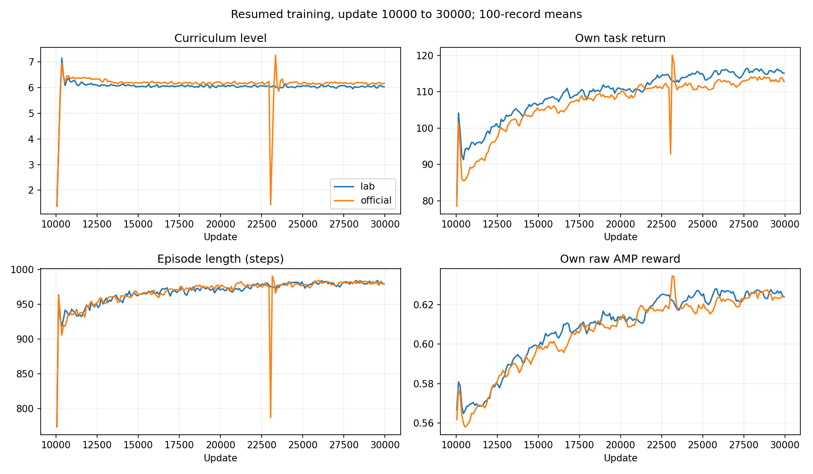

# 30000-update evaluation

Both models trained with 4096 environments, seed 42, 24 rollout steps, five PPO epochs and four minibatches. Each started at 10,000 updates and resumed to 30,000. The Lab3 model uses `Hiking-G1-AMP-Unfiltered-v0`; the official model uses InstinctLab/PhysX.

## Success rates

| Terrain | Lab3 10k | Lab3 30k | Official 10k / Newton | Official 30k / Newton | Official 30k / PhysX |
|---|---:|---:|---:|---:|---:|
|rough|100.0%|100.0%|100.0%|100.0%|100.0%|
|gap|99.2%|100.0%|99.5%|100.0%|99.9%|
|stair_down|98.1%|99.9%|96.1%|99.6%|100.0%|
|platform_down|100.0%|100.0%|99.6%|100.0%|100.0%|
|stair_up|98.9%|100.0%|90.8%|100.0%|100.0%|
|platform_up|5.1%|99.7%|0.0%|100.0%|100.0%|
|large_box|20.5%|99.6%|9.7%|92.2%|94.1%|
|small_box|28.0%|87.6%|25.5%|86.8%|95.7%|
|ramp|100.0%|100.0%|60.5%|100.0%|99.9%|
|Overall|72.20%|98.53%|64.63%|97.62%|98.84%|

## Evaluation protocol

Each column contains 9000 trials: nine terrain types, 100 environments per terrain, ten reset waves on fixed maps. Both 30k policies run sequentially in one Newton scene. Initial root pose/velocities, joint positions/velocities and target positions are hashed and asserted equal for each wave. [State hashes](initial_state_signatures.json). The 10k columns come from the earlier evaluation on 2026-11-10. Official native PhysX results use a separate scene with the same evaluation protocol.

Success means reaching within 0.25 m of the target within 15 s, without simultaneous physical failure. Maximum forward command is 0.55 m/s. Observation noise, material randomization and curriculum are disabled. Contact, tilt and out-of-bounds terminations are active; root-height termination is removed. Fixed geometry: 0.6 m gap; 0.2 m stairs; 0.4 m platforms and large obstacles; small-box mean height 0.3 m; ramp angle 0.4 rad.

| Outcome | Lab3 30k / Newton | Official 30k / Newton | Official 30k / PhysX |
|---|---:|---:|---:|
|successes|8868|8786|8896|
|failures|82|107|28|
|timeouts|50|107|76|

## Training and reference changes

The unfiltered task removes speed-threshold window rejection, early reference resampling around flagged transitions and the first-90% reset-start restriction, and includes tail frames. The 10k filtered Lab3 baseline scored 44.23% overall in the earlier evaluation; its unfiltered counterpart scored 72.20%. After resuming, unfiltered Lab3 reaches 98.53%.

Lab3 completed its additional 20k updates in 23.85 hours. Official training was interrupted at logged update 23291 by a service stop and host restart. It resumed from the saved 23000 checkpoint for 7000 further updates; the final segment took 9.80 hours. Policy, discriminator, optimizer states, update counter and adaptive PPO learning-rate scalar are restored at resume. Environments and curricula initialize anew. The official curve combines the pre-interruption and recovery segments at update 23000.

## Video and data

[45-second comparison](../../artifacts/lab3_vs_official_30000.mp4): Lab3 left, official right; both execute in Newton. Rough, gap and stair-up each show the fixed first trial. Frames freeze 0.06 s before the terminal step to omit the automatic reset.

- [Success counts and rates](success_rates.json)
- [Protocol, motion and final-model SHA-256](protocol.json)
- [Training curves](training_comparison.png)
- [Success-rate plot](success_comparison.png)
